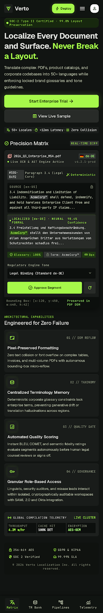

# Verto — Enterprise Localization Infrastructure

**Verto** is a high-precision localization and translation operations platform engineered for deterministic terminology enforcement, document vector reflow, and zero-collision multi-locale workflows.

---
<div align="center">
  
</div>

## Core Capabilities

- **Precision Matrix (REAL-TIME DIFF)** — Sub-segment AST diff review with locked terminology tokens, automated bounding-box containment verification (`0px` drift), and regulatory tone selection.
- **01 // Vector Layout Reflow** — Pixel-preserved formatting across tables, complex invoices, and multi-column document structures.
- **02 // Terminology Vault (TM Bank)** — Centralized, cryptographic glossary enforcement preventing generative drift across 50+ target locales.
- **03 // Automated Quality Gate** — Segment-level BLEU, COMET, and semantic fidelity scoring executed prior to human sign-off.
- **04 // Enterprise Governance** — Role-based access control (RBAC), SAML 2.0 / Okta directory sync, and zero-retention data boundaries.

---

## Project Structure

```text
src/
├── components/
│   ├── Footer.jsx / Footer.css       # Compliance badges, legal metadata & system status
│   ├── Icons.jsx                     # Monochrome & chartreuse technical status glyphs
│   ├── Logo.jsx                      # Minimalist geometric 'V' mark & wordmark
│   ├── MobileNav.jsx / MobileNav.css # Responsive viewport dock (Matrix, TM Bank, Pipelines, Telemetry)
│   ├── Navbar.jsx / Navbar.css       # Top navigation, workspace switcher & deployment trigger
│   └── Toast.jsx                     # Terminal-style telemetry notifications
├── hooks/
│   └── useTranslate.js               # Multi-engine routing layer & locale catalog
├── pages/
│   ├── Home.jsx / Home.css           # Workbench preview, core telemetry & architecture overview
│   ├── Pricing.jsx / Pricing.css     # Tiered licensing (Team, Growth, Enterprise SLA)
│   ├── SegmentWorkbench.jsx          # Live segment diff & approval interface
│   ├── DocumentPipeline.jsx          # Batch document ingestion & vector reflow viewer
│   ├── MediaLocalization.jsx         # Audio synthesis & video subtitle engine
│   └── TerminologyVault.jsx          # Locked glossaries, regex masks & TM database
├── App.jsx
├── main.jsx
└── index.css
